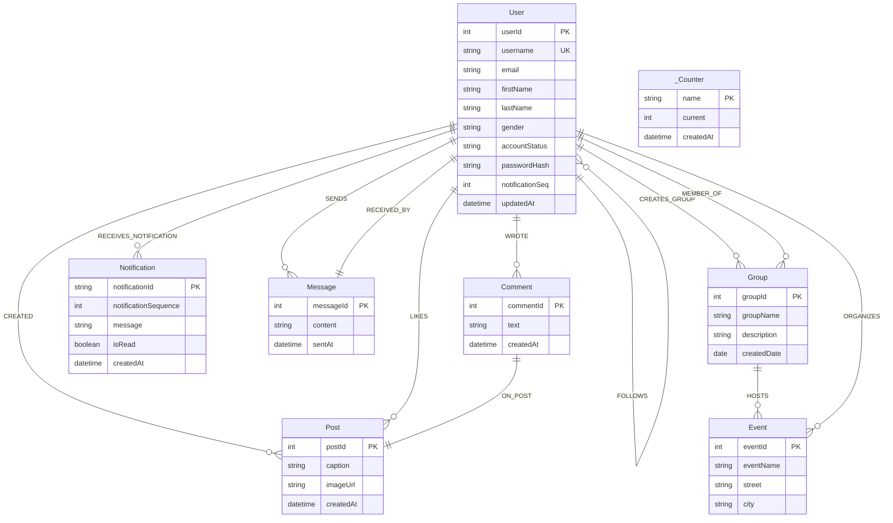

# Neo4j Aura Graph Data Model — DBMS Social Networks (DA3)

This document provides the authoritative technical reference for the graph data model implemented in the DBMS Social Networks project. All labels, properties, relationship directions, uniqueness constraints, and transactional counter mechanisms documented herein reflect the actual live database schema and application codebase.

---

## 1. Graph Architecture & Schema Overview

The database is hosted on a cloud **Neo4j Aura** instance (`neo4j+s://`). The domain model represents a property graph consisting of **8 node labels**, **12 relationship types**, and **7 active uniqueness constraints**.

### Visual Schema Diagram (Mermaid)



---

## 2. Node Labels & Property Specifications

### 2.1 `User`
Represents an individual user profile and account identity in the social network.

| Property | Type | Required | Description | Example |
| :--- | :--- | :--- | :--- | :--- |
| `userId` | Integer | Yes | Unique monotonic integer identifier (Primary Key) | `101`, `102` |
| `username` | String | Yes | Unique login handle / display handle | `'aditya_demo'`, `'srisha_demo'` |
| `email` | String | Yes | Account email address (private, never exposed to other users) | `'aditya@vitstudent.ac.in'` |
| `firstName` | String | Yes | User's first name | `'Aditya'` |
| `lastName` | String | Yes | User's last name | `'Shaw'` |
| `gender` | String | No | Gender specification | `'male'`, `'female'` |
| `accountStatus` | String | Yes | Account state | `'active'` |
| `passwordHash` | String | Yes | Bcrypt-hashed password (cost factor 10, strictly server-side) | `'$2a$10$...'` |
| `notificationSeq` | Integer | No | Recipient sequence tracker for atomic notification ID generation | `1`, `2`, `3` |
| `updatedAt` | DateTime | No | Timestamp of latest profile or password modification | `datetime()` |

### 2.2 `Post`
Represents user-generated posts rendered in the Instagram-style feed.

| Property | Type | Required | Description | Example |
| :--- | :--- | :--- | :--- | :--- |
| `postId` | Integer | Yes | Unique monotonic integer identifier (Primary Key) | `201`, `202`, `203` |
| `caption` | String | Yes | User caption / text content | `'Sharing a beautiful day'` |
| `imageUrl` | String | No | Optional URL to image media (fallback typography card rendered if absent) | `'https://...'` |
| `createdAt` | DateTime | Yes | Post creation timestamp | `datetime()` |

### 2.3 `Comment`
Represents user comments attached to a specific post.

| Property | Type | Required | Description | Example |
| :--- | :--- | :--- | :--- | :--- |
| `commentId` | Integer | Yes | Unique monotonic integer identifier (Primary Key) | `301`, `302`, `303` |
| `text` | String | Yes | Comment content | `'Looks wonderful!'` |
| `createdAt` | DateTime | Yes | Timestamp when the comment was authored | `datetime()` |

### 2.4 `Notification`
Represents notifications dispatched to recipient users for social activities (likes, comments, follows).

| Property | Type | Required | Description | Example |
| :--- | :--- | :--- | :--- | :--- |
| `notificationId` | String | Yes | Composite identifier formatted as `"<recipientUserId>-<seq>"` | `'101-1'`, `'101-2'` |
| `notificationSequence` | Integer | Yes | Monotonic sequence number scoped to the recipient | `1`, `2`, `3` |
| `message` | String | Yes | Human-readable notification content | `'@aditya_demo liked your post'` |
| `isRead` | Boolean | Yes | Read/unread status flag | `false`, `true` |
| `createdAt` | DateTime | Yes | Notification creation timestamp | `datetime()` |

### 2.5 `_Counter`
Internal transactional sequence node providing concurrency-safe ID allocation for graph entities.

| Property | Type | Required | Description | Example |
| :--- | :--- | :--- | :--- | :--- |
| `name` | String | Yes | Entity type identifier | `'Post'`, `'Comment'` |
| `current` | Integer | Yes | Current maximum allocated identifier | `203`, `303` |
| `createdAt` | DateTime | Yes | Timestamp of counter initialization | `datetime()` |

### 2.6 Extended Schema Nodes (Pre-existing in Aura)
The database contains pre-existing schema entities for extended social graph capabilities:
- **`Group`**: Properties `groupId` (Integer, PK), `groupName`, `description`, `createdDate`.
- **`Event`**: Properties `eventId` (Integer, PK), `eventName`, `street`, `city`.
- **`Message`**: Properties `messageId` (Integer, PK), `content`, `sentAt`.

---

## 3. Relationships & Directions

In Neo4j property graphs, relationship directions are fundamental to query semantics and index performance. The table below outlines all verified relationships, exact directions, and relationship properties:

| Relationship Pattern | Direction | Properties | Business Rule / Semantic |
| :--- | :--- | :--- | :--- |
| `(User)-[:CREATED]->(Post)` | Outgoing from author | None | Links an author user to a post they created. |
| `(User)-[:LIKES]->(Post)` | Outgoing from liker | `createdAt` (DateTime), `likeDate` (Date) | User liked a post. Enforces 1 like per user-post pair via `MERGE`. |
| `(User)-[:WROTE]->(Comment)` | Outgoing from author | None | Links a user to a comment they authored. |
| `(Comment)-[:ON_POST]->(Post)` | Outgoing from comment | None | Links a comment node to its parent post node. |
| `(follower:User)-[:FOLLOWS]->(followed:User)` | Outgoing from follower | `followDate` (Date), `createdAt` (DateTime) | Asymmetric social graph edge. Follower points to followed user. |
| `(User)-[:RECEIVES_NOTIFICATION]->(Notification)` | Outgoing from recipient | None | User receives a notification node. Enables fast per-user notification queries. |
| `(User)-[:SENDS]->(Message)` | Outgoing from sender | None | Author user transmits a direct message node. |
| `(Message)-[:RECEIVED_BY]->(User)` | Outgoing from message | None | Message is directed to the recipient user. |
| `(User)-[:CREATES_GROUP]->(Group)` | Outgoing from creator | None | User founded or registered a group. |
| `(User)-[:MEMBER_OF]->(Group)` | Outgoing from member | `memberNumber` (Int), `joinDate` (Date) | User is an active member of a group. |
| `(Group)-[:HOSTS]->(Event)` | Outgoing from group | None | Group hosts an organized event. |
| `(User)-[:ORGANIZES]->(Event)` | Outgoing from organizer | None | User coordinates an event. |

---

## 4. Uniqueness Constraints & Indexes

Active constraints verified directly via `SHOW CONSTRAINTS` on the live Neo4j Aura instance:

```cypher
-- 1. Comment identifier uniqueness
CREATE CONSTRAINT comment_id_unique FOR (c:Comment) REQUIRE c.commentId IS UNIQUE;

-- 2. Post identifier uniqueness
CREATE CONSTRAINT post_id_unique FOR (p:Post) REQUIRE p.postId IS UNIQUE;

-- 3. User identifier uniqueness
CREATE CONSTRAINT user_id_unique FOR (u:User) REQUIRE u.userId IS UNIQUE;

-- 4. Notification identifier uniqueness
CREATE CONSTRAINT notification_id_unique FOR (n:Notification) REQUIRE n.notificationId IS UNIQUE;

-- 5. Group identifier uniqueness
CREATE CONSTRAINT group_id_unique FOR (g:Group) REQUIRE g.groupId IS UNIQUE;

-- 6. Event identifier uniqueness
CREATE CONSTRAINT event_id_unique FOR (e:Event) REQUIRE e.eventId IS UNIQUE;

-- 7. Message identifier uniqueness
CREATE CONSTRAINT message_id_unique FOR (m:Message) REQUIRE m.messageId IS UNIQUE;
```

*Note on Indexes:* Each uniqueness constraint automatically creates and maintains a backing `RANGE` index on the respective property in Neo4j. In addition, built-in token `LOOKUP` indexes (`index_460996c0` for nodes and `index_1b9dcc97` for relationships) optimize label and relationship type scans.

---

## 5. Concurrency-Safe ID & Sequence Allocation

### 5.1 The Concurrency Problem
A naive approach such as `MATCH (p:Post) RETURN max(p.postId) + 1 AS nextId` creates a severe **race condition** under concurrent requests: two concurrent transactions will read the same maximum ID, attempt to insert conflicting records, and trigger constraint violations or lost updates.

### 5.2 The `_Counter` Node Solution
Entities with global integer IDs (`Post`, `Comment`) utilize dedicated `(:_Counter { name: $entityName })` nodes.
1. Neo4j acquires an **exclusive write lock** on the specific `_Counter` node when `SET c.current = c.current + 1` executes.
2. Concurrent write transactions are serialized at the database lock level.
3. If an unexpected transient conflict occurs, the official `neo4j-driver` transaction function (`session.executeWrite()`) automatically retries with exponential backoff.
4. **Baseline Reconciliation:** If a counter node is uninitialized or falls behind existing IDs, the write transaction reconciles `Math.max(baseline, counterVal, maxExistingId)` so sequence numbers never collide or regress.

```cypher
// Concurrency-safe atomic Post ID allocation
MATCH (c:_Counter { name: 'Post' })
SET c.current = c.current + 1
WITH c.current AS nextPostId
MATCH (u:User { userId: $authorId })
CREATE (p:Post {
  postId: nextPostId,
  caption: $caption,
  imageUrl: $imageUrl,
  createdAt: datetime()
})
CREATE (u)-[:CREATED]->(p)
RETURN p.postId AS postId, p.caption AS caption, p.imageUrl AS imageUrl, toString(p.createdAt) AS createdAt
```

### 5.3 Notification Sequence Allocation
Notifications use a composite ID: `notificationId: "<recipientUserId>-<sequenceNumber>"`.
- To avoid global contention across all users, sequence numbers are **scoped per recipient user**.
- When a notification is generated inside a write transaction, an exclusive lock is acquired on the recipient user node:
  ```cypher
  MATCH (recipient:User { userId: $recipientId })
  SET recipient.notificationSeq = coalesce(recipient.notificationSeq, 0) + 1
  WITH recipient, recipient.notificationSeq AS seq
  CREATE (n:Notification {
    notificationId: toString(recipient.userId) + '-' + toString(seq),
    notificationSequence: seq,
    message: $message,
    isRead: false,
    createdAt: datetime()
  })
  CREATE (recipient)-[:RECEIVES_NOTIFICATION]->(n)
  RETURN n.notificationId AS notificationId
  ```

---

## 6. Demonstration Cypher Queries (Read-Only)

The following parameterized Cypher queries can be executed in Neo4j Browser or Aura Workspace to inspect and demonstrate the graph:

### Query 1: Inspect User Profiles & Social Graph Counts
```cypher
MATCH (u:User)
RETURN u.userId AS userId,
       u.username AS username,
       u.firstName + ' ' + u.lastName AS fullName,
       COUNT { (u)-[:CREATED]->(:Post) } AS postsCount,
       COUNT { ()-[:FOLLOWS]->(u) } AS followerCount,
       COUNT { (u)-[:FOLLOWS]->() } AS followingCount
ORDER BY u.userId ASC;
```

### Query 2: Feed Posts with Author, Likes, and Comments Count
```cypher
MATCH (author:User)-[:CREATED]->(p:Post)
OPTIONAL MATCH (liker:User)-[:LIKES]->(p)
OPTIONAL MATCH (commenter:User)-[:WROTE]->(c:Comment)-[:ON_POST]->(p)
RETURN p.postId AS postId,
       p.caption AS caption,
       author.username AS authorUsername,
       toString(p.createdAt) AS createdAt,
       count(DISTINCT liker) AS likeCount,
       count(DISTINCT c) AS commentCount
ORDER BY p.createdAt DESC;
```

### Query 3: Inspect Comments on a Specific Post
```cypher
MATCH (commenter:User)-[:WROTE]->(c:Comment)-[:ON_POST]->(p:Post { postId: 201 })
RETURN c.commentId AS commentId,
       c.text AS commentText,
       commenter.username AS authorUsername,
       toString(c.createdAt) AS createdAt
ORDER BY c.createdAt ASC;
```

### Query 4: Inspect Social Follow Connections
```cypher
MATCH (follower:User)-[r:FOLLOWS]->(followed:User)
RETURN follower.username AS follower,
       followed.username AS followed,
       toString(r.createdAt) AS followedAt;
```

### Query 5: Unread Notifications for a User
```cypher
MATCH (u:User { userId: 101 })-[:RECEIVES_NOTIFICATION]->(n:Notification)
RETURN n.notificationId AS id,
       n.message AS message,
       n.isRead AS isRead,
       toString(n.createdAt) AS receivedAt
ORDER BY n.createdAt DESC;
```

---

## 7. Known Concurrency Limitations & Operational Notes

1. **Transactional Boundaries**:
   - Each state-modifying API request (`createPost`, `likePost`, `createComment`, `followUser`) executes within a single managed write transaction (`session.executeWrite`).
   - If an error occurs during notification generation, the entire transaction (including post, comment, like, or follow creation) rolls back atomically, guaranteeing zero orphaned nodes or partial edges.
2. **Neo4j Aura Connection Limits**:
   - In free/low-tier Neo4j Aura instances, concurrent connection pools are limited. Backend tests and high-throughput scripts should utilize sequential execution (`--fileParallelism=false`) to avoid connection timeouts.
3. **Counter Node Pre-initialization**:
   - The application handles missing `_Counter` nodes gracefully by dynamically bootstrapping them to the maximum existing entity ID via `MERGE`. Administrative setup scripts (`initPostCounter.ts`, `initCommentCounter.ts`) are provided in `backend/src/scripts/` for explicit initial provisioning.
